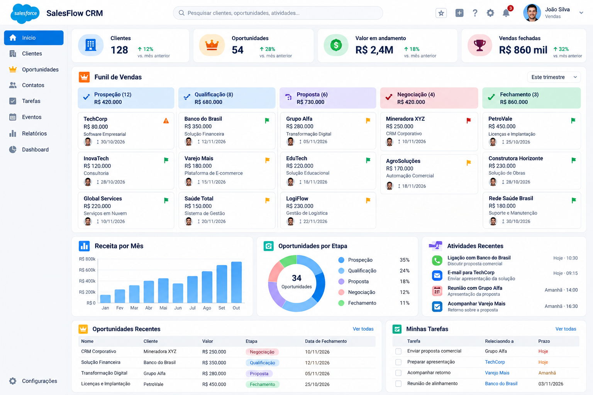

# SalesFlow CRM

  

> **Repositório de portfólio** · Desenvolvimento Salesforce com Apex, LWC e SOQL · Documentação em português.

**Salesforce DX · Apex · Lightning Web Components (LWC) · SOQL · GitHub Actions**

Aplicação de CRM comercial com dashboard, funil de vendas, clientes e tarefas, criada para demonstrar desenvolvimento **nativo no Salesforce**. O projeto usa objetos padrão da plataforma e pode ser implantado em uma **Developer Edition** sem contratação de licença adicional para estudos.

> **Status: v0.2.0 implantada e testada em Salesforce Developer Edition** (deploy `0Afbm00000lOgRFCA0`, 10/10 testes Apex). **Dark Mode v0.3.0** implantado (deploy `0Afbm00000lYBIvCAO`, 10/10 testes Apex) e apresentado na interface Salesforce; a prévia local também utiliza tema Dark. **Arquitetura Enterprise em desenvolvimento na branch**, ainda aguardando validação do novo Service Layer. A prévia utiliza somente dados fictícios e não se conecta ao Salesforce.



## Navegação do repositório

- [Arquitetura e trade-offs](docs/ARQUITETURA.md) · [Service Layer v0.3.0](docs/V030_SERVICE_LAYER.md) · [ADR-0001](docs/adr/0001-objetos-nativos-salesforce.md)
- [Operação e deploy Salesforce](docs/OPERACAO_SALESFORCE.md) · [Publicação GitHub](docs/GITHUB_PUBLICACAO.md)
- [Demonstração para recrutadores](docs/DEMO_RECRUTADORES.md) · [Roadmap](docs/ROADMAP.md)
- [Como contribuir](CONTRIBUTING.md) · [Segurança](SECURITY.md) · [Histórico de alterações](CHANGELOG.md)

## Entregas da v0.2.0

| Módulo | Implementação Salesforce | Prévia local |
|---|---|---|
| Dashboard comercial | Contagem de contas, contatos, oportunidades; valor aberto e ganho | Sim, com dados simulados |
| Funil por etapa | Colunas dinâmicas conforme etapas disponíveis na organização | 5 etapas de demonstração |
| Oportunidades | Criar via `lightning-record-edit-form`, alterar etapa, pesquisar/filtar e paginar no Salesforce (SOQL com LIMIT 20/OFFSET e USER_MODE) | Criar, buscar, filtrar por etapa e alterar etapa |
| Clientes | Exibir, buscar, abrir e criar com ação padrão do Salesforce | Criar, listar e buscar |
| Contatos | Lista de até 30 contatos recentes, busca local e abertura/cadastro pelo padrão Salesforce | Listar, buscar e criar contatos fictícios |
| Tarefas | Listar pendências, abrir/criar e concluir com Apex no modo usuário | Marcar concluída localmente |
| Relatórios | Resumo dos valores e quantidade por etapa | Gráficos + exportação CSV |
| Segurança | `with sharing`, `WITH USER_MODE` e `update as user` | Nenhuma autenticação (apenas demo) |
| Testes | Classe Apex com casos de leitura, atualização de etapa e conclusão de tarefa | `node --check` + verificador estrutural |

**Escopo explícito:** a v0.2.0 não inclui login próprio, multi-tenant SaaS, gateway de pagamento, integração com Java/Spring Boot, disparo de e-mails, relatórios mensais, integração Kafka ou deploy automatizado em produção. Esses são caminhos de evolução, não funcionalidades já entregues.

## 1. Prévia rápida (Windows, sem instalar nada)

1. Clone o repositório com Git (ou atualize com `git pull` se já estiver no IntelliJ).
2. Abra `preview/index.html` no Chrome, Edge ou outro navegador moderno.
3. Teste o modo Dark/Light, menu, busca, criação de cliente e oportunidade, mudança de etapa, tarefas e exportação CSV.

Os registros são **100% fictícios**, salvos apenas no `localStorage` do navegador. Não existe backend conectado nessa visualização. Para redefinir a prévia, limpe os dados do site no navegador ou as chaves que começam em `salesflow.demo`.

## 2. Pré-requisitos para executar no Salesforce

- Conta gratuita [Salesforce Developer Edition](https://developer.salesforce.com/signup).
- [Visual Studio Code](https://code.visualstudio.com/) e Salesforce Extension Pack.
- [Salesforce CLI](https://developer.salesforce.com/tools/salesforcecli).
- Git (e conta no GitHub para publicação).
- Acesso de administrador à organização de estudo ou permissões equivalentes para metadados/objetos.

> O componente consulta `Account`, `Contact`, `Opportunity` e `Task`. O usuário precisa das permissões de leitura nos campos usados, criação de oportunidades para o formulário, atualização de oportunidade para mudar o estágio e atualização de Task.Status para concluir tarefas. A classe Apex tem Permission Set que libera sua execução. Uma Developer Edition normalmente é suficiente para o estudo, mas as permissões e os estágios dependem da configuração da organização.

### Passo a passo via PowerShell

Abra um terminal **na pasta raiz extraída**:

```powershell
sf --version
sf org login web --alias salesflow-dev --instance-url https://login.salesforce.com --set-default
sf org list
sf project deploy start --source-dir force-app --target-org salesflow-dev --wait 20
sf org assign permset --name SalesFlow_User --target-org salesflow-dev
sf apex run test --tests SalesFlowControllerTest --target-org salesflow-dev --result-format human --wait 20
```

Em algumas Developer Editions com domínio My Domain, o login pode exigir URL própria da organização. Ajuste `--instance-url` nesses casos.

**Popular ambiente de estudo (opcional):**

```powershell
sf apex run --file scripts/apex/seed.apex --target-org salesflow-dev
```

O seed cria registros **reais, mas fictícios**, dentro da sua organização Salesforce de estudo. Não execute em ambientes produtivos. Ele não cria os registros da prévia local nem apaga dados preexistentes.

### Adicionar o dashboard ao Salesforce

1. No Salesforce, abra **Setup** (engrenagem) → **Lightning App Builder**.
2. Clique em **New** → **App Page** e dê o nome `SalesFlow CRM`.
3. Escolha um template de página de **uma coluna**.
4. Procure o componente customizado **SalesFlow CRM Dashboard** e arraste para a região principal.
5. Clique em **Save**, depois **Activate** e configure a navegação/disponibilidade da página na aplicação desejada.
6. Abra a página pelo App Launcher ou pelo item de navegação que você acabou de ativar.

O componente também oferece os targets `lightning__HomePage` e `lightning__Tab`. A aparência final depende da largura e do tema Lightning da organização. O mockup em `docs/` é apenas referência visual.

## 3. Organização e arquitetura

```text
salesflow-crm/
├── force-app/main/default/
│   ├── classes/
│   │   ├── SalesFlowController.cls
│   │   └── SalesFlowControllerTest.cls
│   ├── lwc/salesFlowDashboard/
│   │   ├── salesFlowDashboard.html
│   │   ├── salesFlowDashboard.js
│   │   ├── salesFlowDashboard.css
│   │   └── salesFlowDashboard.js-meta.xml
│   └── permissionsets/SalesFlow_User.permissionset-meta.xml
├── preview/                  # demonstração estática local, dados fake
│   ├── index.html
│   ├── app.js
│   └── styles.css
├── scripts/
│   ├── apex/seed.apex
│   └── validate.py
├── docs/
│   ├── conceito-visual.png
│   ├── ARQUITETURA.md
│   └── ROADMAP.md
├── .github/
│   ├── workflows/validate.yml
│   ├── ISSUE_TEMPLATE/
│   └── PULL_REQUEST_TEMPLATE.md
├── CHANGELOG.md
├── CONTRIBUTING.md
├── SECURITY.md
├── .gitignore
└── sfdx-project.json
```

```text
Lightning Web Component (salesFlowDashboard)
       |    @wire / ação
       v
Apex SalesFlowController
       |    WITH USER_MODE / update as user
       v
Objetos nativos Salesforce: Account / Contact / Opportunity / Task
```

Não existe banco externo nesta versão: os dados residem no Salesforce. Em versões futuras, a arquitetura prevista usa Java 21 / Spring Boot para integrações REST com sistemas externos.

## 4. Segurança e limites técnicos

- A classe `SalesFlowController` usa `with sharing` e todas as operações de leitura/escrita estão em **modo usuário**, aplicando permissões de registros, objetos e campos.
- Mudanças de estágio validam o valor contra as opções ativas no `Opportunity.StageName`; regras e restrições adicionais do Salesforce continuam sendo aplicadas pela plataforma.
- Os KPIs usam contagens e somas independentes dos limites de listagem. O kanban carrega **até 150 oportunidades recentes**, contas e contatos até 30 cada e tarefas até 30. A tela de oportunidades tem **paginação diretamente no servidor Salesforce** na tela de oportunidades (20 por página e busca pelo nome da oportunidade ou conta), limitada pelo teto de `OFFSET 2000` (101 páginas). A tela de funil mantém a amostra das 150 oportunidades mais recentes; outras listagens são amostras locais.
- Os números monetários assumem **BRL** no componente e na prévia. Organizações com multicurrency exigem adaptação dos KPIs para evitar somar moedas sem conversão.
- O relatório de etapas considera todos os registros visíveis ao usuário. A busca na tela **Oportunidades** consulta diretamente a org. O dashboard/kanban mantém seus KPIs globais e 150 cartões mais recentes, portanto o filtro de pesquisa não altera os valores globais do relatório.
- O usuário final deve receber a permissão necessária para executar a classe Apex. `SalesFlow_User` concede apenas **acesso à classe** e **não modifica** as permissões padrão dos objetos/fields.
- A aplicação **não implementa uma autenticação paralela**; usa o gerenciamento de sessão e o modelo de acesso nativos do Salesforce.
- Na prévia, `localStorage` serve somente para persistência de dados falsos do navegador. Nunca inserir dados reais/sensíveis na demonstração.

### Testes

Verificação estrutural local (necessita Python e Node):

```bash
python scripts/validate.py
```

No ambiente Salesforce:

```bash
sf apex run test --tests SalesFlowControllerTest --target-org salesflow-dev --result-format human --wait 20
```

A execução local **não compila Apex** nem verifica o funcionamento de LWC em uma org. Documente o resultado do deploy e a cobertura Apex real quando concluir essa etapa.

## 5. Publicar no GitHub

O ZIP vem sem `.git` nem credenciais. Confira o [guia de publicação](docs/GITHUB_PUBLICACAO.md). Para o método manual, crie no GitHub um repositório **vazio** chamado `salesflow-crm`, sem marcar geração automática de README ou LICENSE. Depois:

```powershell
cd C:\Projetos\salesflow-crm
git init -b main
git add .
git commit -m "feat: release SalesFlow CRM v0.2.0"
git remote add origin https://github.com/SEU_USUARIO/salesflow-crm.git
git push -u origin main
```

O GitHub pedirá autenticação conforme a configuração do Git Credential Manager/SSH. **Nunca versione token Salesforce, `.sf/`, `.sfdx/`, senhas, refresh token, chaves privadas ou arquivos `.env`.**

**Alternativa: publicação com um comando.** Se tiver [GitHub CLI](https://cli.github.com/) instalado e já tiver executado `gh auth login`, use este script incluído no ZIP:

```powershell
.\scripts\publicar-github.ps1 -GitHubUsuario SEU_USUARIO
```

O script cria o repositório público `salesflow-crm` (ou usa um repositório existente sob a mesma conta) e faz push. Para criar um repositório **privado**, acrescente `-Visibility private`. O comando executa mudanças **na sua própria conta GitHub** quando você o roda; nenhum repositório é criado automaticamente pelo ZIP.

### Fluxo de versões sugerido

```text
main                         releases estáveis
  └── develop                integração
       ├── feature/contacts
       ├── feature/v0.2.0-search-opportunities
       └── feature/java-salesforce-integration
```

Ao concluir e validar no Salesforce:

```powershell
git tag -a v0.2.0 -m "SalesFlow CRM v0.2.0"
git push origin v0.2.0
```

## 6. Critérios para demonstrar a recrutadores

1. Mostrar o dashboard no Salesforce com registros reais de demonstração (não apenas HTML).
2. Criar uma oportunidade pelo formulário nativo.
3. Mudar a etapa e mostrar que o dado permaneceu salvo no Salesforce.
4. Abrir `SalesFlowController.cls` e explicar `with sharing`, `WITH USER_MODE` e DML em modo usuário.
5. Executar a classe de teste Apex na organização e mostrar os resultados.
6. Explicar a paginação de oportunidades no servidor (e limite de OFFSET), o dashboard com amostra de 150 registros e o roadmap de integração Java.

Esse roteiro comprova habilidades de CRM, Apex, SOQL, LWC, CRUD/FLS, Git e documentação técnica — sem declarar funcionalidades que não existem.

## Referências

- [Targets e arquivos de configuração LWC](https://developer.salesforce.com/docs/platform/lwc/guide/reference-configuration-tags.html)
- [Segurança Apex em Lightning Web Components](https://developer.salesforce.com/docs/platform/lwc/guide/apex-security)
- [Deploy com Salesforce CLI](https://developer.salesforce.com/docs/platform/salesforce-cli-reference/guide/cli_reference_project_deploy_start.html)
- [Trailhead — desenvolver com Apex](https://trailhead.salesforce.com/pt-BR/content/learn/projects/quickstart-apex)

## Licença

MIT — consulte `LICENSE`. Este é um projeto educacional independente; não é produto oficial nem endossado pela Salesforce.


---

**Nota de versão:** esta edição contém melhorias de documentação e governança para publicação no GitHub. O código Apex/LWC continua sujeito à primeira validação numa org Salesforce.
